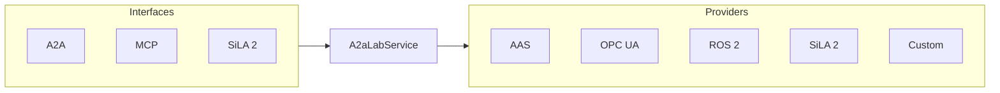

# A3 Analytics A2A-LAB devkit

<p align="center">
  <a href="https://a3analytics.ai/"></a>
</p>

[](https://github.com/A3Analytics/a2a-lab-dev-kit-rs/actions/workflows/a2a-tck.yml)

The A3 Analytics A2A-LAB devkit is a Rust crate for lab logs, metrics, tasks, and images. Agent2Agent (A2A) and Model Context Protocol (MCP) expose all twelve operations. SiLA 2 serves logs, metrics, tasks, and named-source images. AAS, OPC UA, and ROS 2 stay on logs, metrics, and tasks.

## Features

- Supports lab logs, metrics, tasks, and images over Agent2Agent (A2A) and Model Context Protocol (MCP).
- Serves logs, metrics, tasks, and named-source images to Standardization in Lab Automation (SiLA) 2 clients. Image bytes use SiLA binary download.
- Connects to a remote SiLA 2 server and exposes configured members as lab tasks, logs, and metrics.
- Reads equipment from an AAS catalog.
- Reads Open Platform Communications Unified Architecture (OPC UA) equipment history.
- Supplies live OPC UA readings through `LiveSource`. [Upcoming]
- Exposes Robot Operating System 2 (ROS 2) actions as lab tasks.

## Interfaces and providers

The following diagram shows the interfaces and providers around `A2aLabService`:



A2A, MCP, and SiLA 2 call `A2aLabService`. `A2aLabService` uses AAS, OPC UA, ROS 2, SiLA 2, and Custom. SiLA 2 is both the inbound interface and a remote provider. The inbound server also serves named-source images through binary download.

## Run the logs, metrics, and tasks example

Run these commands from the repository root.

1. Install the tools:

   ```bash
   mise install
   ```

2. Run the [logs, metrics, and tasks example](examples/logs_metrics_tasks.rs):

   ```bash
   mise exec -- cargo run --example logs_metrics_tasks
   ```

## Open the optional web interface

The web interface stays off unless the `web-ui` feature is enabled and the application calls `A2aServer::with_web_ui`.

Run the [web interface example](examples/web_ui.rs) from the repository root:

```bash
mise exec -- cargo run --example web_ui --features web-ui
```

The example listens on `http://127.0.0.1:3847/ui/` unless `WEB_UI_BIND` is set. To use the local webcam as the video source instead of the synthetic bench recording, run `mise run web-ui-webcam`. `WEB_UI_WEBCAM_INDEX` selects another camera, starting at `0`. To rebuild and restart the bench example when `web-ui/`, `examples/web_ui.rs`, or the crate sources change:

```bash
mise run web-ui-watch
```

Refresh the tab after a restart. This is a full `wasm32` compile, not Vite-style HMR. A downstream application enables the same Cargo feature and calls `A2aServer::with_web_ui`. It does not copy the `web-ui` sources.

## Check A2A-LAB compliance

A2A-LAB compliance tests deterministic lab-operation behavior and A2A/MCP parity. The authoritative [contract](https://github.com/A3Analytics/a2a-lab-tck/blob/1fd47d5c73e6fa3f7bd6505d75e43ee68cae33fd/backlog/docs/reference/compliance/doc-1%20-%20A2A-LAB-TCK-profile.md), [runner](https://github.com/A3Analytics/a2a-lab-tck/blob/1fd47d5c73e6fa3f7bd6505d75e43ee68cae33fd/src/compliance_runner.rs), and [GitHub Action](https://github.com/A3Analytics/a2a-lab-tck/blob/1fd47d5c73e6fa3f7bd6505d75e43ee68cae33fd/action.yml) are maintained in the standalone [A2A-LAB TCK](https://github.com/A3Analytics/a2a-lab-tck). Pin consumers to the full published commit SHA `1fd47d5c73e6fa3f7bd6505d75e43ee68cae33fd`.

The devkit `v0.1.0` release at `9d5327868d96b3e800fd89f6debf434bcc12709d` is the last release with the embedded TCK. Its Action contract remains immutable. The current repository-root Action is a deprecated compatibility bridge to the standalone revision.

Use the standalone [A2A-LAB TCK documentation](https://github.com/A3Analytics/a2a-lab-tck/blob/1fd47d5c73e6fa3f7bd6505d75e43ee68cae33fd/README.md) to create fixtures, pin its Action, retain the JSON report, and display the consumer repository's workflow badge. That badge reports only the consumer-owned workflow result; it is not certification or a devkit badge.

## Configuration priority

`LoadedLabConfig::load` reads one required JSON file, then applies two optional layers. Later layers replace earlier values.

1. The base file, such as `a2a-lab.json`.
2. The sibling `<stem>.secret.<ext>` in the same directory, such as `a2a-lab.secret.json`. The whole sibling document is deep-merged. A missing sibling is skipped. A sibling that exists but cannot be read or parsed fails the load.
3. `TYPESAFE_API_KEY`, which replaces only `typesafe.api_key`.

`typesafe` accepts `api_key` and is removed before the remaining document is validated, so the key is absent from settings, logs, and `Debug`. An empty key fails the load. When none of these layers supplies a key, image decisions and semantic decisions fall back to the environment variable named by their `credentials.env` field.

`a2a-lab.secret.json`:

```json
{
  "typesafe": {
    "api_key": "replace-with-your-typesafe-key"
  }
}
```

## Configure application logging

Application logging is optional. Add a `logging` section to `a2a-lab.json`, call `init_logging_from_loaded` before starting A2A, MCP, SiLA, or a direct `A2aLabService` host, and keep the returned guard for the process lifetime. Omitted `logging.format` uses human-readable stderr text; set `"format": "json"` or the `otel` feature for explicit structured export.

## Open the crate documentation

Generate the application programming interface (API) documentation with this command:

```bash
mise exec -- cargo doc --no-deps --open
```

## Check the crate

1. Build the crate:

   ```bash
   mise run build
   ```

2. Test the crate:

   ```bash
   mise run test
   ```

3. Run the quality checks:

   ```bash
   mise run quality-fast
   mise run quality
   ```

`mise run quality-fast` is the iteration gate. It checks formatting, the SiLA matrix, complexity, duplication, compilation, Clippy, and tests. It disables nextest retries and does not start the external conformance containers.

`mise run quality` is the merge gate. It runs that same local work, then the A2A TCK and the SiLA provider checks, and it keeps nextest retries.
