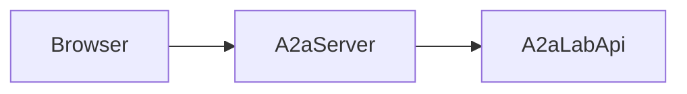

# Open the optional web interface

The optional web interface is a browser for one lab agent that already speaks Agent2Agent (A2A). It stays off until an application enables the `web-ui` Cargo feature and calls `A2aServer::with_web_ui`. Headless A2A and Model Context Protocol (MCP) behavior is unchanged when that opt-in is absent.

## Enable the interface

The feature in this crate is:

```toml
web-ui = ["dep:wasm-bindgen-cli-support"]
```

`default` is `aas`, `opcua`, and `sila2`. `web-ui` is absent from `default`.

A downstream application enables that feature on its `a2a-lab-dev-kit` dependency and calls the public API:

```rust
A2aServer::new(&service).with_web_ui()
```

`with_web_ui` is compiled only with the `web-ui` feature. The constant `WEB_UI_PATH` is `/ui/`. The listener serves the page at `GET /ui`, `GET /ui/`, and `GET /ui/index.html`. Packaged assets are under `/ui/assets/`.

Those page and asset routes are public and carry no agent data or credentials. A2A protocol routes keep the access gate configured on `A2aServer`.

With the feature omitted, `with_web_ui` is absent and `/ui/` is not a route. With the feature compiled and `with_web_ui` left uncalled, `/ui/` is still absent. In both cases the A2A and MCP routes stay as they are.

Adoption is that dependency feature plus `A2aServer::with_web_ui`. Downstream applications do not copy the `web-ui` sources. They do not patch `a2a-lab-ot2` or another downstream repository to carry the interface.

## Build and check the browser package

The shell is Rust compiled to `wasm32-unknown-unknown`. `rust-toolchain.toml` pins Rust `1.98.1` and that target. The `web-ui` build script packages the shell when this crate compiles with the feature. `wasm-bindgen-cli-support` is pinned to `0.2.129`.

Run these commands from the repository root after `mise install`:

```bash
mise run web-ui-build
mise run web-ui-freshness
mise run web-ui-feature-off
```

`mise run web-ui-build` checks the shell, including the wasm32 target, and checks this crate with `--all-features`.

`mise run web-ui-freshness` fails when the generated assets disagree with the shell sources.

`mise run web-ui-feature-off` checks that a default build and a `--no-default-features` build omit the web UI dependencies, and that `A2aServer::with_web_ui` is absent.

## Run the example

[web_ui.rs](../../../../examples/web_ui.rs) starts an in-memory agent, opts into the packaged interface, prints the local URL, and keeps listening.

Run these commands from the repository root.

1. Install the tools:

   ```bash
   mise install
   ```

2. Run the example:

   ```bash
   mise exec -- cargo run --example web_ui --features web-ui
   ```

The example prints a line of the form `http://127.0.0.1:<port>/ui/`. Open that URL. Stop the process to shut the listener down.

The process inserts this representative data:

- Log source `app`, with one info record `lab ready` at `2024-01-01T00:00:00Z`.
- Metric `latency`, with one sample of value `5` at that same timestamp.
- Task definition `build`.
- Image source `bench`, with a 1 by 1 PNG frame `current`.
- An `agent-message` handler that replies `echo` plus the user text.

`MemoryLogs`, `MemoryMetrics`, `MemoryTasks`, and `MemoryImages` hold that data in the process. `A2aLabService::with_images` attaches the image catalog. `with_message_handler` advertises `agent-message`.

## Browser client

The following diagram shows the browser on the existing A2A HTTP+JSON path:



In the preceding diagram, the browser calls `A2aServer`. `A2aServer` calls `A2aLabApi`.

The page is a same-origin A2A HTTP+JSON client. It calls the listener that served `/ui/`. It is the same A2A surface as `A2aClient`. It is not a new provider or a new protocol, and it does not add a second API.

It loads `GET /.well-known/agent-card.json`, then uses the HTTP+JSON routes on [A2A](<../../reference/a2a/doc-4 - A2A.md>).

The page browses the four [A2A-LAB primitives](<../../reference/primitives/doc-17 - A2A-LAB-primitives.md>): logs, metrics, tasks, and images. Primary navigation is Agent, Logs, Metrics, Tasks, Images, and Chat. The A3 Analytics logo and the A2A Lab name sit at the top of that navigation. Agent is the default. Older hashes still open the matching page: `#overview` opens Agent, and `#inventory`, `#inventory/logs`, and `#workbench` open Logs.

Each primitive page lists that primitive and runs its commands:

- Logs runs `list_log_sources` and `query_logs`. The page is a list: a filter sidebar toggles sources, searches messages, limits the UTC date range, and narrows severity, and the other column shows those records as cards, each with its source. The source catalog and the command runner stay off that page.
- Metrics runs `list_metrics` and `query_metric`. The page is a list: the sidebar lists each metric so one click switches the series, a start and end limit the UTC time range, and the other column draws those samples as a line graph that fills the column. Hovering a point shows that sample's time and value, and the graph resizes with the page. A visually hidden list keeps the same readings for assistive technology. The catalog and the command runner stay off that page.
- Tasks runs `list_tasks`, `start_task`, and `get_task_status`.
- Images runs `list_image_sources`, `list_images`, `search_images`, `get_image`, and `get_current_image`.

Choosing a row action stays on that page and fills the matching command. A log source, metric, task, or image source is chosen from a dropdown of the items listed on that page. The filled command stays until Send or until another primitive page replaces it with that page's first command. Command history is page memory, at most 20 entries, and a reload drops it. A continued list keeps the cursor returned by the latest chunk.

Lab commands omit `contextId`, matching `A2aClient::send_request`. Chat sends `contextId` after the server has returned one.

Agent shows identity, interfaces, skills, capabilities, the bearer token, and raw protocol controls. Raw protocol stays inside Advanced.

## Sessions and server memory

A chat conversation is the A2A `contextId` returned by the server for the current page load. The first turn omits `contextId`. Each later turn sends that id. Each turn receives a new protocol task id. The conversation has no title and is not listed.

A lab run id is separate. `start_task` asks the task provider to allocate a run id for that call. `MemoryTasks` uses `run-1`, `run-2`, and so on. That run id is not the protocol task id.

`A2aServer` keeps protocol tasks in an in-memory task store. `A2aLabService` keeps command snapshots in memory. Stopping the process drops both.

Enter sends the draft. Shift+Enter inserts a line break. New session clears the current `contextId`, the transcript, and the draft. Reload starts a new conversation.

Chat is disabled when the agent card does not advertise `agent-message`. The status text says chat is unavailable because the agent does not advertise that skill. Lab commands stay available on the primitive pages. That disabled state is different from an advertised handler that later returns unavailable.

## Privacy and security

The page does not write chat history, command history, or credentials to `localStorage`, `sessionStorage`, or cookies. A conversation exists only in the current page. Reload drops it.

When the card requires HTTP bearer authentication, the token is a password field on Agent. `autocomplete` is off. The field lives for that page load. Reload clears it. The token is sent only in the `Authorization` header. The page refuses a command or chat message whose visible text contains the token.

The page can call an agent with no security requirements, or an agent whose requirement is HTTP bearer. It lists and refuses schemes it cannot satisfy:

- API key
- OAuth 2
- OpenID Connect
- mutual TLS
- an HTTP scheme other than bearer
- one requirement that mixes bearer with any of those schemes
- a security requirement the card does not describe

The Security section lists each unsupported scheme. The page will not send credentials or call that agent. Chat stays disabled, and the status says chat is unavailable for this agent.

A rejected bearer token shows Unauthorized on the protocol panel. A token that lacks the required scope shows Forbidden. A chat send that is unauthorized or forbidden reports that failure and leaves the draft available for retry.

## Rendering, previews, and browsers

Agent-provided strings are written as text. The page does not insert agent content as HTML. Chat, primitive lists, protocol output, and command results are plain text. Displayed text redacts a bearer token that appears in a response.

Image preview is separate from the server limit. `ImageTransportConfig` defaults to 64 MiB of decoded bytes. The browser previews `image/png`, `image/jpeg`, `image/gif`, and `image/webp` only when the decoded payload is at most 262144 bytes. A larger payload, or any other media type, including SVG, stays a text summary. A preview that is allowed uses a `data:` URL.

The shell needs a browser that runs WebAssembly, JavaScript modules, and `fetch` on the same origin. Repository checks open the page in headless Chromium. The page includes a skip link, a navigation landmark labeled Lab sections, labeled fields, and live regions for connection, each primitive, the command runner, and chat status. Alerts use an assertive live region. The layout follows the light or dark color scheme. This is a lab browser for the packaged agent, not a production administration console.

## Non-goals

The page has these boundaries:

- It does not discover remote agents. It talks only to the origin that served it.
- It does not broker credentials across origins.
- It does not run an OAuth or OpenID Connect login flow.
- It does not configure providers. Provider setup stays in the Rust process that builds `A2aLabService`.
- It does not add production administration controls.

## Related

- [A2A](<../../reference/a2a/doc-4 - A2A.md>)
- [A2A-LAB primitives](<../../reference/primitives/doc-17 - A2A-LAB-primitives.md>)
- [A2A-LAB devkit overview](<../../overview/doc-10 - Lab-dev-kit-overview.md>)
- [Run the memory lab](<../memory-lab/doc-12 - Run-the-memory-lab.md>)
- [Serve A2A and MCP](<../a2a-and-mcp/doc-13 - Serve-A2A-and-MCP.md>)
- [web_ui.rs](../../../../examples/web_ui.rs)
- [README](../../../../README.md)
