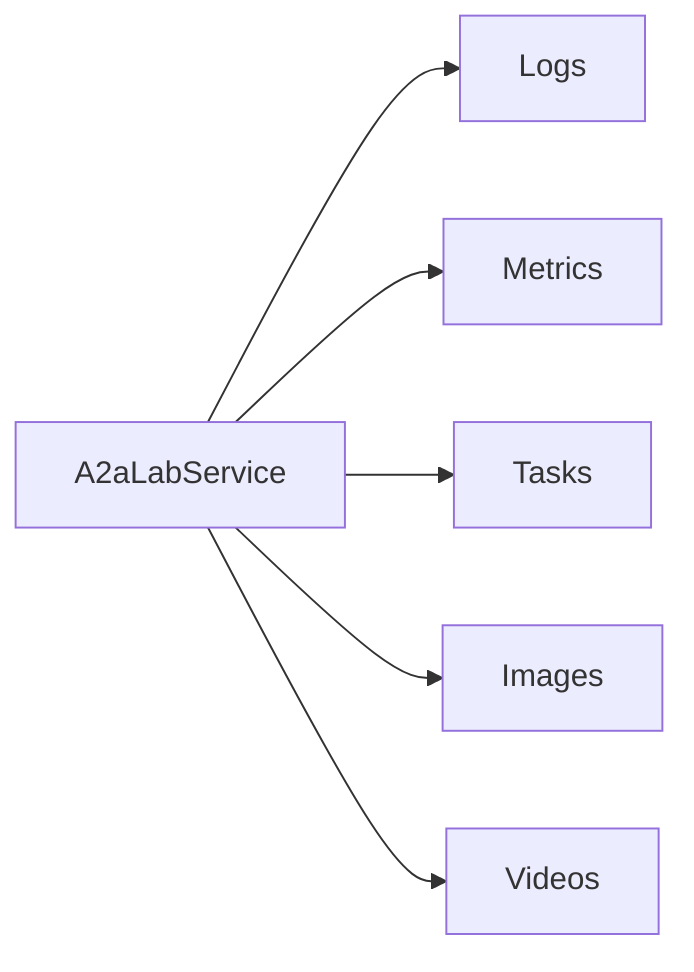

# A2A-LAB primitives

A2A-LAB primitives are the logs, metrics, tasks, images, and optional videos shared by every interface and provider. [Interfaces and providers](<../interfaces-and-providers/doc-19 - Interfaces-and-providers.md>) names those two sides. The [A2A-LAB devkit overview](<../../overview/doc-10 - Lab-dev-kit-overview.md>) shows where they sit.

## Primitives

The following diagram shows the primitives `A2aLabService` uses. Videos is optional:

In the preceding diagram, `A2aLabService` uses logs, metrics, tasks, images, and optional videos.

### Logs

A log source is a named stream. A log record is one line from that stream. Each record has a UTC timestamp, a severity, a message, and a JSON attribute object.

Severity is `trace`, `debug`, `info`, `warn`, or `error`.

### Metrics

A metric descriptor names one measurement and its unit. A metric point is one finite sample at a UTC timestamp.

### Tasks

A task definition is work an agent can start. It can carry JSON Schema for the input and the result. A task run is one start of that definition. The run input is a JSON object. A finished run can carry a JSON result, observable progress, and a SiLA error kind and identifier.

A run state is `submitted`, `working`, `completed`, `failed`, or `canceled`. `completed`, `failed`, and `canceled` are terminal.

### Images

An image source names a place that can supply frames. It has an id, a name, and a description. Optional fields are `asset_id` and `semantic_id`.

This crate does not open an HTTP endpoint, a USB device, or an IP camera. It does not include a source helper, a capture helper, or a built-in source adapter. A provider supplies the frames.

An image descriptor is metadata for one frame. It has an id, a source id, a Coordinated Universal Time (UTC) capture time, an `image/*` media type, a width, a height, an optional caption, and a JSON attribute object. A descriptor does not include pixel bytes.

An image pairs that descriptor with inline bytes. JSON carries those bytes as standard base64. Base64 uses four characters for every three decoded bytes, so the JSON text is about one third larger than the payload.

Limits apply to decoded bytes. `ImageTransportConfig` defaults to 64 MiB. A 3840x2160 payload at four bytes per pixel is about 31.6 MiB and fits that default. A large 24 megapixel PNG can exceed 64 MiB. `Image::new` uses the default. A provider that creates a larger payload uses `Image::with_transport`.

Configure the same decoded-byte maximum on the service and on each client. They do not share one limit automatically. `A2aLabService::with_image_transport` sets the service limit. `A2aClient::with_image_transport` sets the Agent2Agent (A2A) client limit. `McpLab::connect_with` sets the Model Context Protocol (MCP) client limit. `Image` JSON decoding stays at 64 MiB unless the caller passes the raised `ImageTransportConfig` into those methods. For MCP Streamable HTTP, pass the raised limit to `McpLab::connect_with` before the connection opens so the HTTP event window grows before the first image is read. `McpLab::with_image_transport` after connect changes decoding only.

`get_current_image` names a source. It is not an image lookup with a missing id. The provider defines the current frame. That frame can be newly captured, taken from video, or the latest stored image. `MemoryImages` uses `set_current` when a frame was selected. Otherwise it returns the latest captured frame for that source, with the image id as the tie break.

`A2aLabService::new` still takes logs, metrics, and tasks. Image operations return `unavailable` until `with_images`. MCP does not expose image resources. Agent2Agent (A2A) and MCP do not offer URI-only image delivery. SiLA 2 `LabImages` lists sources and returns one image by id or current source. Those pixel bytes always use SiLA binary download. Search and list-by-time stay on Agent2Agent (A2A) and Model Context Protocol (MCP). Saved still images remain exclusively in this Images primitive. Videos neither browses nor owns them.

### Videos

A video source names a place that can supply retained video. It has an id, a name, a description, width, height, fps, and a media type. Encoded sources use H.264 or H.265 without JPEG transcoding. MJPEG sources keep the multipart MJPEG media type. Optional fields are `asset_id` and `semantic_id`.

This crate supplies contracts and transport. It does not capture cameras and does not persist recordings. A provider owns recording, indexing, retention, clip expiry, and live-subscription cancellation. The provider coalesces rotated files or partitions into one logical interval. The timeline API rejects reversed, overlapping, or abutting intervals. A genuine temporal gap remains a separate later interval. Empty retention is a successful timeline with no intervals and no newest timestamp. Supply only metadata the provider actually has.

`get_video_timeline` returns that ordered coverage for one source, including whether live follow can be prepared. It does not open a stream.

`get_video_frame_at` remains the public name. It extracts a frame at time: the nearest retained JPEG at a UTC instant from retained video. Ties choose the earlier frame. Empty coverage, a request outside retained coverage, or a coverage gap is `not_found`. Coverage is never silently clamped. The response may include that extracted JPEG as inline base64. It is not a saved image.

`get_video_clip` remains the public name. It prepares a short-lived finite playback session for one half-open UTC range, `[start, end)`. The catalog accepts an arbitrary retained range. There is no 60-second catalog limit. The shared packager serves a bounded HLS/CMAF window (default 120 seconds) with `#EXT-X-PROGRAM-DATE-TIME` and `#EXT-X-DISCONTINUITY` at genuine gaps, not one playlist for the full retained span. A range that misses retained coverage is `no_recording`. A range that crosses a gap between retained intervals may still succeed when the provider returns every retained frame in `[start, end)` and sets `effective_range` to the actual covered bounds `[first_frame.captured_at, last_frame.captured_at + frame_period)`. `MemoryVideos` uses that rule, including when rolling retention (`forget_before`) trims the leading edge but the requested range still overlaps retained frames. Other providers may still answer with `recording_gap` when they require contiguous coverage inside the requested range. `no_recording` applies only when zero retained frames fall inside the requested range. Invalid or reversed ranges are `invalid`. Agent2Agent (A2A) and Model Context Protocol (MCP) return session metadata only: id, source, requested and effective ranges, media type, a relative gateway root `/media/video-clips/{id}/`, and optional 8x trick-play metadata. Clip JSON never includes video bytes. `GET /media/video-clips/{id}/` is the gateway root for bounded HLS assets or a finite MJPEG multipart body. The optional web interface skips genuine gaps while playing and shows `Skipped gap.` An expired handle is `clip_expired`. An unknown handle is `not_found`.

`follow_video` prepares a genuine live-follow session for frames captured after the stream opens. The handle is metadata only: an opaque id, the source id, media type, a relative gateway root `/media/video-live/{id}/`, and optional 8x metadata. It contains no frame bytes. `GET /media/video-live/{id}/` follows that source through the gateway. A source that cannot be followed is `live_unavailable`. The subscription ends when the consumer drops it or the provider stops the source.

Both media responses use `Cache-Control: no-store` and `X-Content-Type-Options: nosniff`. The bearer token is sent only in the `Authorization` header. There is no public route, byte range, or shared cache. When security requirements are configured, the `/media/video-*` gateway uses the protocol access gate on A2A and on the MCP HTTP listener. Those routes are not public `/ui` routes. The `/mcp` host allowlist does not cover them. [A2A and MCP protocols](<../../technical/protocol/doc-2 - A2A-and-MCP-protocols.md>) records that access. SiLA 2 `LabVideos` 1.1 returns a timeline and a finite BinaryDownload clip (MP4 or MJPEG). It has no follow command.

These four availability failures keep stable codes. The user-facing sentences are:

- `no_recording`: "No recording covers the requested range."
- `recording_gap`: "The recording contains a gap."
- `clip_expired`: "The clip expired."
- `live_unavailable`: "Live video is unavailable."

Agent2Agent (A2A) carries those codes in `ErrorInfo` `metadata.code`. Model Context Protocol (MCP) tool errors carry them in `data.code`. Media `GET` failures carry them in `error.code`. Generic `invalid`, `not_found`, and `unavailable` stay those codes. They do not always use dedicated sentences on the A2A task path.

Video operations return `unavailable` until `with_videos`.

## Operations

`A2aLabService` runs these operations:

1. `list_log_sources` lists log sources.
2. `query_logs` reads records for one source.
3. `list_metrics` lists metrics.
4. `query_metric` reads samples for one metric.
5. `list_tasks` lists tasks.
6. `start_task` starts a task.
7. `get_task_status` reads one run.
8. `list_image_sources` lists image sources.
9. `list_images` returns descriptors for one source. The page does not include pixel bytes.
10. `search_images` returns descriptors that match an optional source plus a half-open UTC range, nonblank text, or both. A source id alone is not a search. The page does not include pixel bytes.
11. `get_image` returns one image, including its inline base64 bytes.
12. `get_current_image` returns the provider-defined current frame for one source, including its inline base64 bytes.
13. `list_video_sources` lists video sources.
14. `get_video_frame_at` extracts a frame at time from retained video. The public name stays `get_video_frame_at`.
15. `get_video_clip` prepares a finite playback session for one half-open retained range. Agent2Agent (A2A) and Model Context Protocol (MCP) return metadata and a relative gateway root. Clip bytes are not in JSON.
16. `get_video_timeline` returns ordered retained intervals for one source. Empty retention succeeds with no intervals and no newest timestamp.
17. `follow_video` prepares a live-follow handle. The handle is metadata only. Frame bytes are not in JSON.

Time ranges are half-open Coordinated Universal Time (UTC) intervals, `[start, end)`.

## Shared values

These values apply to every primitive:

- An identifier is 1 to 128 characters. Allowed characters are ASCII letters, digits, `.`, `_`, `:`, and `-`.
- A timestamp is UTC in RFC 3339 form. The offset is `Z`, `+00:00`, or `-00:00`.
- A time range is half-open, `[start, end)`. `start` is included. `end` is excluded. `start` is before `end`.
- A page limit is 1 to 1000. The default limit is 100. A cursor is an optional string of digits.
- An error code is `invalid`, `not_found`, `unavailable`, `transport`, or `protocol`. Video availability also uses `no_recording`, `recording_gap`, `clip_expired`, and `live_unavailable`.
